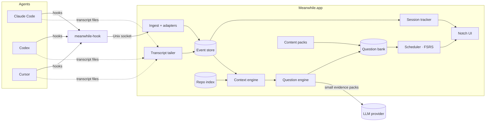
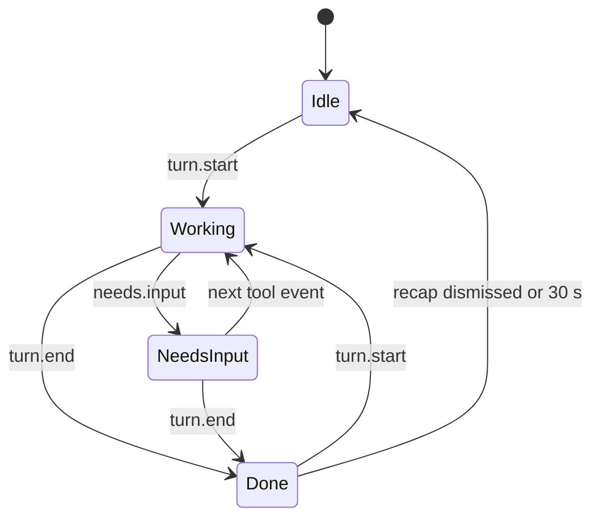
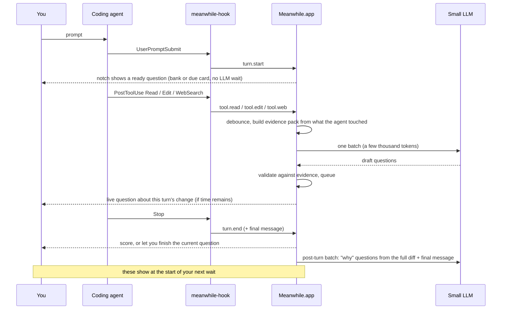

# Architecture

## Overview

Meanwhile has two parts:

1. **`meanwhile-hook`**: a tiny command-line program. Each agent's hook config calls it on every event. It reads the event JSON from stdin, sends it to the app over a local socket, and exits. It never blocks the agent and never prints a decision.
2. **`meanwhile run`**: a background process (Swift, AppKit, SwiftUI views) with a menu bar icon. It owns everything else: session tracking, the repo index, question generation, scheduling, and the notch UI. The same `meanwhile` program also has `setup` and `uninstall` commands. Meanwhile ships as a command-line tool, not a `.app` ([decision](README.md#decisions-so-far)).



The transcript tailer is there for events the hooks don't expose, mainly web searches in Codex and Cursor ([integrations.md](integrations.md#gaps-and-how-we-fill-them)).

## Components

### meanwhile-hook (CLI)

- Written in Swift or Go as a single static binary, installed to `~/Library/Application Support/Meanwhile/bin/`.
- Called as `meanwhile-hook <agent> <event>`. Reads stdin, adds `agent`, a timestamp, `TERM_PROGRAM` and the tty (so the app can jump back to the right terminal), and writes one line to the socket.
- Target: exits in under 50 ms. Exit code is always 0 and stdout is always empty, so the agent never reads it as a decision.
- If the app isn't running, it appends the event to a spool file. The app drains the spool on launch.
- On Claude Code it is registered with `"async": true`, so the agent doesn't wait for it at all.

### Ingest and adapters

Each agent has an adapter that turns its raw hook payload into one shared event shape ([schema](integrations.md#shared-event-schema)). Everything after this layer is agent-agnostic.

### Event store

SQLite, local only. It keeps a rolling 30 days of events by default (configurable), because events contain code and prompts.

### Session tracker

One state machine per agent session:



- **Working**: questions may show.
- **NeedsInput**: questions hide at once and the notch shows "Agent needs you". The quiz must never hide a permission prompt.
- **Several sessions at once**: the notch shows how many are running. Questions follow the session whose turn started most recently.

### Repo index (no LLM)

A local index of each repo where Meanwhile is turned on: docs split by heading, file map, symbols, and git history. It costs no LLM tokens to build. Details: [question-engine.md](question-engine.md#3-a-local-repo-index-built-without-an-llm).

### Context engine

Builds a small **evidence pack** for each question batch from (a) what the agent touched this turn and (b) the repo index. It also removes secrets. See [question-engine.md](question-engine.md#4-evidence-packs-small-scoped-inputs).

### Question engine

Turns evidence packs into questions with a small, cheap model. It then checks each question against its evidence and drops any that fail. See [question-engine.md](question-engine.md#generators).

### Content packs

The generic decks (LLM fundamentals, system design, prompting) are curated, versioned JSON shipped with the app. They need no LLM at runtime.

They are fully customizable:
- Turn decks and topics on or off.
- Add, edit or delete cards.
- Import and export JSON.
- Create your own deck ("Postgres indexing"). The LLM writes it once, then it is stored and editable like any pack.

### Scheduler

- **Spacing**: FSRS schedules spaced review for every card. Your confidence answer ("Guessed / Fairly sure / Knew it") feeds the scheduler.
- **Selection** respects deck and topic toggles, the work/learning mix, the question limit per wait, and interleaving across decks.

## One agent turn, end to end



Two timing rules come from this diagram:

- **The first question shows instantly.** It comes from the bank or a due review card, never from a fresh LLM call. A MIT study of quizzes during short waits found people answered most when the card appeared right as the wait began ([research.md](research.md#learning-science)).
- **Questions about turn N mostly show during turn N+1.** By then the generator has the full diff and the agent's own summary, so the questions are better. The gap also adds a little spacing, which helps memory.

## The notch app

### Window

- Menu bar agent app (`LSUIElement`), with launch at login through `SMAppService`.
- The notch surface is a borderless `NSPanel` with `.nonactivatingPanel`:
  - Collection behavior: `canJoinAllSpaces`, `fullScreenAuxiliary`, `stationary`.
  - Window level: above the menu bar.
- [DynamicNotchKit](https://github.com/MrKai77/DynamicNotchKit) (MIT) handles notch geometry and falls back to a floating pill on Macs and displays without a notch.
- Do not copy boring.notch. It is GPL-3.0.
- Minimum macOS 14.
- **With several displays:** Meanwhile shows on the display holding the agent's terminal or editor window, found from the `TERM_PROGRAM` and tty the hook captured. If that can't be found, it uses the built-in notch.
- When the panel is compact or idle, it passes mouse events through everywhere except its own shape, so it never blocks menu bar clicks.

### States

| State | Look | Trigger |
|---|---|---|
| Idle | Plain notch, no change | No session working |
| Working, compact | Pulsing dot and timer on the left; question count on the right | `turn.start` |
| Expanded | About 600 × 280 pt below the notch: question, answers, feedback. Static: an answer is saved on click, and nothing moves on until the user picks Next (⌃⌥↩) or a confidence | Hover to peek, click to open |
| Needs input | Attention color, "Agent needs you"; click jumps to the terminal. Keeps what was on screen to come back to, and fades back after 5 s, since Claude Code sends no event when the user approves | `needs.input` |
| Done | Check mark and score for about 4 s, then idle; click opens the recap | `turn.end` |

### Focus: never steal the terminal

- **Answers are clicks.** Keys 1–4 work only while the pointer is over the expanded notch.
- **Typing is explicit.** The panel becomes key only when you click into a short-answer field. On submit it hands focus back.
- **Why it matters:** a non-activating panel that becomes key still takes keyboard focus from the terminal, so we avoid that by default ([source](https://developer.apple.com/forums/thread/818901)).
- **Jump back:** "Jump to agent" uses the `TERM_PROGRAM` and tty captured by the hook to bring the right terminal or editor window forward.

### Respecting attention

- Pause during screen sharing and when a Focus mode is on.
- **Verify:** there is no general public API for reading Focus state. `INFocusStatusCenter` only reports whether Focus is on, and only for apps with the communication entitlement.
- Auto-pause for short turns: if your recent turns in a repo end in under about 10 s, show nothing until 10 s have passed.

## Storage layout

```
~/Library/Application Support/Meanwhile/
  meanwhile.db        SQLite: events, sessions, repos, doc_chunks (FTS5),
                      questions, evidence, reviews (FSRS), settings
  packs/              generic decks, versioned JSON
  spool/              events written while the app was closed
  bin/meanwhile-hook
  meanwhile.sock      Unix socket
```

## Privacy

- **Local first.** Everything is stored locally. The only data that leaves the machine is the evidence packs sent to the LLM provider the user picks, or nothing at all with a local model.
- **Per-repo opt-in.** Meanwhile ignores a repo until you turn it on.
- **Ignore rules.** It respects `.gitignore` and `.meanwhileignore`.
- **Redaction.** Before any LLM call, it removes secrets: `.env` files, key patterns, and high-entropy strings.
- **Off switches.** Each deck can be switched off. The research deck sends web snippets, not code.
- **Agent transcripts are plaintext on disk** ([Claude Code docs](https://code.claude.com/docs/en/claude-directory)). Meanwhile reads them and does not copy them anywhere.
